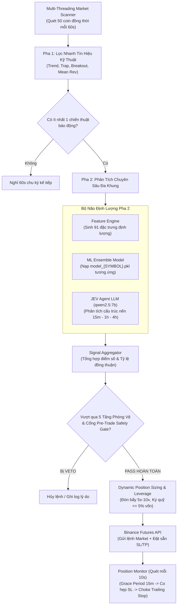

# TRADEMATRIX QUANT ECOSYSTEM - MASTER REFERENCE & GROUND TRUTH
## TÀI LIỆU TOÀN DIỆN VỀ KIẾN TRÚC HỆ THỐNG, BỐI CẢNH 2 MÁY TÍNH, NỀN TẢNG WEB, THUẬT TOÁN BOT & KHO DỮ LIỆU ĐIỂM CHUẨN LỊCH SỬ

> **Phiên bản:** TradeMatrix v2.0 Enterprise & Micro Defense System  
> **Tác giả & Nhà phát triển:** **Lê Hoàng Đức**  
> **Mục đích tài liệu:** Bản ghi nguồn sự thật duy nhất (Single Source of Truth - SSOT). Khi tạo một hội thoại mới (*New Conversation in Project*), tài liệu này cung cấp 100% bối cảnh kiến trúc, quy trình làm việc giữa 2 máy tính, thuật toán phòng vệ, và toàn bộ kho dữ liệu lệnh lịch sử để không bao giờ bị mất điểm chuẩn (benchmarks).

---

## MỤC LỤC
1. [Bối Cảnh Vận Hành & Kiến Trúc Phân Bổ 2 Máy Tính](#1-bối-cảnh-vận-hành--kiến-trúc-phân-bổ-2-máy-tính)
2. [Hệ Sinh Thái Web & Động Cơ Giao Diện 3D](#2-hệ-sinh-thái-web--động-cơ-giao-diện-3d)
3. [Kiến Trúc Bộ Lõi Tool Bot (TradeMatrix Client v2.0)](#3-kiến-trúc-bộ-lõi-tool-bot-tradematrix-client-v20)
4. [Bộ 5 Tầng Phòng Vệ Vi Mô & Cổng Pre-Trade Safety Gate](#4-bộ-5-tầng-phòng-vệ-vi-mô--cổng-pre-trade-safety-gate)
5. [Kho Dữ Liệu Lệnh Lịch Sử & Điểm Chuẩn Đối Chứng Thực Nghiệm](#5-kho-dữ-liệu-lệnh-lịch-sử--điểm-chuẩn-đối-chứng-thực-nghiệm)
6. [Kế Hoạch Quản Trị & Bảo Tồn Dữ Liệu Lịch Sử Điểm Chuẩn](#6-kế-hoạch-quản-trị--bảo-tồn-dữ-liệu-lịch-sử-điểm-chuẩn)
7. [Hướng Dẫn Dành Cho AI Khi Mở Hội Thoại Mới (New Conversation Guide)](#7-hướng-dẫn-dành-cho-ai-khi-mở-hội-thoại-mới-new-conversation-guide)

---

## 1. BỐI CẢNH VẬN HÀNH & KIẾN TRÚC PHÂN BỔ 2 MÁY TÍNH

Hệ thống TradeMatrix được vận hành trên **mô hình phân tán 2 máy tính cục bộ** qua mạng nội bộ (LAN):

```mermaid
flowchart LR
    subgraph PC1["💻 PC1: MÁY PHÁT TRIỂN CHÍNH (DEV MACHINE)"]
        A1["Thư mục Code: d:\\TRADE"]
        A2["Thư mục Web: D:\\WEB_TRADE_BOT"]
        A3["Môi trường: Google Antigravity IDE"]
        A4["Nhiệm vụ: Code, Test, Fix bug, Build Zip, Git Push"]
    end

    subgraph CLOUD["☁️ CLOUDFLARE PAGES / GITHUB"]
        G1["Repo: lehoangduc-trade-web"]
        G2["URL: lehoangduc.pages.dev"]
        G3["Tải Client: TradeMatrix_Client_v2.0.zip"]
    end

    subgraph PC2["🖥️ PC2: MÁY TREO TOOL THỰC CHIẾN 24/7"]
        B1["Đường dẫn mạng LAN: \\\\192.168.1.10\\trade-web\\assets\\TradeMatrix_Client_v2.0"]
        B2["Tài khoản: Gmail phụ / Account độc lập"]
        B3["Binance API: DÙNG CHUNG API TEST VỚI PC1"]
        B4["Nhiệm vụ: Chạy thực tế 24/7, Ghi log, Quản lý vị thế"]
    end

    PC1 -- "1. Git Push Web/Assets" --> CLOUD
    PC1 -- "2. Sync Code trực tiếp qua LAN" --> PC2
    CLOUD -- "3. Tải bản cập nhật" --> PC2
    PC2 -- "4. Bắn lệnh thực tế" --> BINANCE["🟡 BINANCE FUTURES REAL EXCHANGE"]
```



### 1.1. Chi tiết phân vai máy tính:
1. **Máy 1 (PC Phát Triển - Đang làm việc):**
   * **Thư mục mã nguồn:** `d:\TRADE` (bộ mã lõi bot), `D:\WEB_TRADE_BOT` (nền tảng web giới thiệu và đóng gói).
   * **Nhiệm vụ:** Viết mã, gỡ lỗi, kiểm định mô phỏng lịch sử (Backtest/Replay), đào tạo mô hình Machine Learning, đóng gói file `TradeMatrix_Client_v2.0.zip`, đẩy mã nguồn lên GitHub để Cloudflare Pages tự động Deploy.
2. **Máy 2 (PC Treo Tool Thực Chiến - 24/7):**
   * **Đường dẫn truy cập từ xa qua mạng nội bộ:** `\\192.168.1.10\trade-web\assets\TradeMatrix_Client_v2.0`
   * **Bối cảnh tài khoản:** Máy này đăng nhập bằng 1 tài khoản Gmail khác (máy riêng), nhưng **dùng chung 1 bộ API Key Binance với Máy 1** nhằm mục đích kiểm tra và chạy thử nghiệm hiệu năng thực tế trước khi bàn giao cho bạn bè hoặc tích hợp API của người dùng khác.
   * **Môi trường thực thi:** Chạy trực tiếp qua file `START.bat` trên môi trường Python ảo `venv` riêng biệt, tích hợp máy chủ Ollama chạy model LLM `qwen2.5:7b` phân tích đa khung thời gian.

### 1.2. Quy trình đồng bộ chuẩn (Deployment Workflow):
Khi có bất kỳ chỉnh sửa hay sửa lỗi nào trên Máy 1:
1. **Bước 1:** Cập nhật code tại `d:\TRADE\core\bot.py` (hoặc module tương ứng).
2. **Bước 2:** Đồng bộ file trực tiếp sang PC treo: `\\192.168.1.10\trade-web\assets\TradeMatrix_Client_v2.0\...`
3. **Bước 3:** Đóng gói lại file `TradeMatrix_Client_v2.0.zip` và đẩy lên GitHub (`git push`) để web Cloudflare cập nhật.
4. **Bước 4:** Sang PC treo, đóng cửa sổ dòng lệnh hiện tại (`Ctrl + C` hoặc tắt cửa sổ đen) và nhấp đúp `START.bat` để Python nạp mã mới vào bộ nhớ RAM. Bot tự động khôi phục vị thế đang mở từ SQLite `trade_bot.db`.

---

## 2. HỆ SINH THÁI WEB & ĐỘNG CƠ GIAO DIỆN 3D

Nền tảng Web được thiết kế theo tiêu chuẩn công nghệ cao (Cyberpunk / Quantitative Trading Hub), lưu trữ tại thư mục `D:\WEB_TRADE_BOT` và xuất bản trực tiếp lên Internet qua Cloudflare Pages: **`https://lehoangduc.pages.dev`**.

### 2.1. Động cơ 3 Bánh Răng Truyền Động Thực & Tia Sét Ma Trận 3D:
* **Công nghệ:** HTML5 Canvas, Three.js, WebGL không nền đen (trong suốt 100%), không che khuất hiệu ứng sóng nến Three.js 3D phía sau.
* **Tỉ số truyền cơ khí chuẩn xác:**
  * Bánh răng Thép trái ($R=115\text{px}$, 24 răng): Quay thuận chiều kim đồng hồ (CW), chu kỳ 20.0 giây.
  * Bánh răng Titanium giữa ($R=82.8\text{px}$, 17 răng): Quay ngược chiều kim đồng hồ (CCW), chu kỳ 14.4 giây (ăn khớp 1:1 theo vận tốc tiếp tuyến vòm răng).
  * Bánh răng Vàng phải ($R=115\text{px}$, 24 răng): Quay thuận chiều kim đồng hồ (CW), chu kỳ 20.0 giây.
* **Hiệu ứng Nhịp Thở Động Lực Học (Breathing Animation):**
  * Cụm bánh răng co giãn nhịp nhàng từ tỉ lệ `0.94x` đến `1.16x` theo chu kỳ 8.5 giây.
* **Tia Sét Plasma Phân Nhánh & Dòng Ma Trận 2 Chiều:**
  * Tia sét điện toán đánh qua lại giữa các khớp răng cơ khí, cường độ biến thiên theo sóng điều hòa kép (lúc mạnh mẽ, lúc dịu êm).
  * Ma trận số nhị phân (`0101...`) lướt qua lại 2 chiều với mật độ luồng co giãn từ 6 đến 28 luồng.

### 2.2. Bố cục trang Web theo chỉ đạo của Người Sáng Lập:
1. **Mục Người Sáng Lập & Phát Triển (Author Section):**
   * Tiêu đề: **Lê Hoàng Đức · Người xây dựng và phát triển hệ thống TradeMatrix**.
   * Đặt trang trọng ngay trên phần giải thích cơ chế, minh chứng nguồn gốc và bản quyền công nghệ.
2. **Quy Trình 5 Tầng Phòng Vệ Vi Mô (Interactive Defense Pipeline):**
   * Trình chiếu dạng thẻ đồ họa kết nối dòng chảy từ *Tín hiệu vào* $\rightarrow$ *Tầng 1 (Cold-Start)* $\rightarrow$ *Tầng 2 (Dải ADX)* $\rightarrow$ *Tầng 3 (RSI/Wick Trap)* $\rightarrow$ *Tầng 4 (Micro Consensus)* $\rightarrow$ *Tầng 5 (SQLite Cooldown)* $\rightarrow$ *Chấp thuận vào lệnh*.
3. **5 Thẻ Tính Năng Nổi Bật (Cinematic Feature Cards):**
   * Hiệu ứng cuộn trang (Scroll-triggered cinematic reveals) độc lập cho từng thẻ: Tinh giản đòn bẩy động, Choke Trailing Stop, Bẫy cá mập TrapDetector, Đa khung thời gian MTF JEV Agent, Quản trị vốn Drawdown Shield.
4. **Bộ cài Client Download:**
   * Nút bấm tải trực tiếp gói [`TradeMatrix_Client_v2.0.zip`](file:///D:/WEB_TRADE_BOT/assets/TradeMatrix_Client_v2.0.zip) dung lượng ~35MB chứa toàn bộ engine độc lập, file cấu hình và database mẫu.

---

## 3. KIẾN TRÚC BỘ LÕI TOOL BOT (TRADEMATRIX CLIENT V2.0)

TradeMatrix là một hệ thống giao dịch định lượng cao cấp chạy hoàn toàn tự động, tích hợp giữa phân tích kỹ thuật truyền thống, mô hình học máy (Machine Learning) và trí tuệ nhân tạo Agentic LLM:



### 3.1. Các thành phần nòng cốt:
1. **Multi-Threading Market Scanner (`core/scanner.py`):**
   * Quét song song 50 đồng coin thanh khoản cao nhất toàn sàn Binance Futures cùng danh mục Cổ phiếu Mỹ (TradFi Stock Perps).
2. **Feature Engine 91 Chiều (`ai/feature_engine.py`):**
   * Tính toán tức thì 91 chỉ số kỹ thuật và vi mô: EMA20/50/200, RSI đa khung, MACD, Stochastic, Bollinger Bands, ATR, ADX/DMI, Order Flow Imbalance, RVol...
3. **ML Ensemble Models (`data/models/`):**
   * Mỗi đồng coin lớn (BTC, ETH, SOL, SNDK...) sở hữu một mô hình học máy chuyên biệt (`model_{SYMBOL}.pkl`) được huấn luyện với bài toán phân loại đa tầng.
4. **JEV Agent LLM (`ai/jev_agent.py`):**
   * Tích hợp trực tiếp máy chủ Ollama chạy mô hình cục bộ `qwen2.5:7b`.
   * Đọc cấu trúc thị trường đa khung thời gian (15M, 1H, 4H), kiểm tra khối lượng nến và đưa ra cảnh báo phá vỡ giả (Fakeout) hoặc phủ quyết bẫy đi ngang (Consolidation Veto).
5. **Cơ Chế Kép Crypto + Cổ Phiếu Mỹ TradFi (`risk/risk_manager.py`):**
   * Tự động lọc phiên New York (09:30 - 16:00 EST), áp dụng rào chắn cuối tuần (Weekend Shield), miễn trừ tương quan Crypto cho các mã cổ phiếu Mỹ như TSLA, NVDA, AAPL.

---

## 4. BỘ 5 TẦNG PHÒNG VỆ VI MÔ & CỔNG PRE-TRADE SAFETY GATE

Toàn bộ hệ thống phòng vệ được thiết kế để loại bỏ triệt để các lệnh thua trong lịch sử mà **không làm suy giảm bất kỳ lệnh thắng nào**:

```
[Tín Hiệu Vào Lệnh Từ Các Chiến Thuật]
                  │
                  ▼
┌────────────────────────────────────────────────────────┐
│ TẦNG 1: COLD-START WARMUP GUARD                        │
│ ➜ Model ML vừa huấn luyện lại cấp tốc?                 │
│ ➜ JEV Agent chưa khẳng định chắc chắn (HOLD/Conf < 80%)│
│ ➜ HỦY LỆNH (Tránh rủi ro mô hình chưa ổn định)         │
└──────────────────────────┬─────────────────────────────┘
                           │ PASS
                           ▼
┌────────────────────────────────────────────────────────┐
│ TẦNG 2: DẢI BIẾN ĐỘNG ĐỘNG LƯỢNG (ADX BOUNDARIES)      │
│ ➜ ADX < 22.0: Chặn Breakout yếu (Vùng sideway lừa đảo) │
│ ➜ 22.0 <= ADX < 55.0: Xu hướng phát triển mạnh (CHO PHÉP)│
│ ➜ ADX >= 55.0: Chặn Bơm xả cực hạn (Cấm đu đỉnh)       │
└──────────────────────────┬─────────────────────────────┘
                           │ PASS
                           ▼
┌────────────────────────────────────────────────────────┐
│ TẦNG 3: TRẠNG THÁI GIÁ & BẪY NẾN (RSI / WICK TRAP)     │
│ ➜ Lệnh SHORT có RSI 15M <= 35.0: CẤM SHORT ĐU ĐÁY      │
│   (Trừ khi TrapDetector xác nhận râu xả đỉnh Bull Trap)│
└──────────────────────────┬─────────────────────────────┘
                           │ PASS
                           ▼
┌────────────────────────────────────────────────────────┐
│ TẦNG 4: SÀN ĐỒNG THUẬN VI MÔ (MICRO CONSENSUS)         │
│ ➜ AI Ensemble >= 60%: Duyệt bình thường                │
│ ➜ AI 50% - 60%: Bắt buộc ADX >= 30.0 & ATR < 5.0% kèm  │
│   (>= 3 chiến thuật & >= 2 kỹ thuật) HOẶC (JEV >= 80%) │
│ ➜ Bắt buộc ít nhất 1 chiến thuật kỹ thuật độc lập      │
└──────────────────────────┬─────────────────────────────┘
                           │ PASS
                           ▼
┌────────────────────────────────────────────────────────┐
│ TẦNG 5: KHÓA PHẠT NGUỘI BẮT BUỘC (SQLITE COOLDOWN)     │
│ ➜ Cặp tiền vừa dính lệnh lỗ trong 180 phút qua?        │
│ ➜ CẤM VÀO LỆNH (Tránh giao dịch trả thù, đu đỉnh kép)  │
└──────────────────────────┬─────────────────────────────┘
                           │ PASS
                           ▼
┌────────────────────────────────────────────────────────┐
│ CỔNG AN TOÀN TRƯỚC KHI BẮN LỆNH (PRE-TRADE GATE)       │
│ ➜ RVol Gate: Nến đóng iloc[-2] có Volume >= 70% SMA20? │
│ ➜ Volume Exhaustion: Nến iloc[-2] không sụt giảm >50%  │
│   kèm râu từ chối giá (upper/lower shadow > body)      │
│ ➜ Funding Rate Extreme: Tránh phe Long/Short quá đông  │
│ ➜ Order Book Depth Imbalance: Tường cản < 3x           │
└──────────────────────────┬─────────────────────────────┘
                           │ PASS
                           ▼
                 [CHẤP THUẬN BẮN LỆNH LÊN SÀN]
```

### 4.1. Bài Học Xương Máu Về Nến Đóng Cửa (`iloc[-2]`) Tại Pre-Trade Gate:
* **Lỗi tiềm ẩn trước ngày 17/10:** Cổng Pre-Trade Gate lấy nhầm `df_tactical['volume'].iloc[-1]`. Trong nến 15 phút, nến `iloc[-1]` là nến đang chạy (chỉ mới hình thành 1-3 phút), nên khối lượng chỉ đạt 1.9% - 15% trung bình, dẫn đến việc hệ thống hiểu nhầm là "Thanh khoản cạn kiệt" và chặn oan toàn bộ 118 tín hiệu hợp lệ!
* **Quy chuẩn sửa lỗi dứt điểm:** Toàn bộ việc kiểm tra khối lượng phải được thực hiện trên **nến đã đóng cửa hoàn chỉnh (`iloc[-2]`)** đối chiếu với lịch sử các nến đã đóng trước đó (`iloc[:-2]`).

---

## 5. KHO DỮ LIỆU LỆNH LỊCH SỬ & ĐIỂM CHUẨN ĐỐI CHỨNG THỰC NGHIỆM

Đây là **kho tri thức thực nghiệm vô giá** được tích lũy qua toàn bộ lịch sử thực chiến trên Binance Futures từ ngày đầu tiên khởi chạy bot đến nay, đóng vai trò là "Thước đo đối chứng" (Ground Truth) để thẩm định mọi cải tiến thuật toán.

### 5.1. Toàn Bộ 203 Lệnh Thực Chiến Binance (Từ 28/09/2026 Đến 17/10/2026):
* **Nguồn dữ liệu gốc:** Trích xuất trực tiếp 100% từ API sàn Binance Futures (`fapiPrivateGetIncome`) và đồng bộ với database cục bộ `data/trade_bot.db`.
* **Tổng số giao dịch tài khoản (Income Transactions):** **431 bản ghi** (Lưu trữ vĩnh viễn tại [`data/ALL_BINANCE_INCOME_HISTORY.csv`](file:///d:/TRADE/data/ALL_BINANCE_INCOME_HISTORY.csv)).
* **Tổng số lệnh chốt PnL (Realized PnL Closes):** **203 lệnh** (Lưu trữ vĩnh viễn tại [`data/ALL_BINANCE_REALIZED_PNL_HISTORY.csv`](file:///d:/TRADE/data/ALL_BINANCE_REALIZED_PNL_HISTORY.csv)).
  * **Số lệnh Thắng (Wins):** **115 lệnh** (Tỷ lệ thắng thực tế: **56.7%**).
  * **Số lệnh Thua (Losses):** **88 lệnh** (43.3%).
  * **Số lệnh Hòa vốn (BE):** 0 lệnh.
  * **Tổng PnL thực tế tích lũy:** **`-4.8568 USDT`** (Mức lỗ rất nhỏ nhờ cơ chế kiểm soát Drawdown và vị thế nhỏ 5% vốn).
  * **Top 10 cặp tiền thực chiến nhiều nhất:** `SOXL/USDT` (10 lệnh), `SOL/USDT` (9 lệnh), `DUSK/USDT` (9 lệnh), `DOGE/USDT` (7 lệnh), `MANTA/USDT` (7 lệnh), `ZEC/USDC` (6 lệnh), `AXL/USDT` (6 lệnh), `HYPE/USDT` (5 lệnh), `S/USDT` (5 lệnh), `AGT/USDT` (4 lệnh).

### 5.2. Mối Quan Hệ Giữa "Tập Mẫu 105 Vị Thế" và "203 Lệnh Chốt PnL":
* **Làm rõ sự khác biệt:**
  * **203 Lệnh Realized PnL (431 giao dịch):** Là **TOÀN BỘ** lịch sử giao dịch từ ngày 28/09 đến 17/10 trên tài khoản Binance này.
  * **Tập mẫu 105 Vị thế (325 lượt Fills):** Là tập hợp 105 vị thế Round-trip liên tục (từ 29/09 đến 16/10) được trích xuất để làm **bài test giải phẫu nến 1m chuyên sâu**, hạch toán 100% phí Taker 0.05% cả 2 đầu.
* **Kết quả đối chứng trên tập 105 vị thế:**
  * Thuật toán phòng vệ vi mô cứu nguy và tăng lãi cho **42 vị thế** (+7.50 USDT).
  * Giảm **58.5% tổng mức lỗ ròng lịch sử** (từ `-7.94 USDT` về `-3.29 USDT`).
  * Rút ngắn thời gian ngâm lệnh từ **112.8 phút** xuống **31.7 phút** (triệt tiêu căn bệnh Zombie Bleeding giam lệnh âm 23 tiếng như LAB -9.45%, ERA -4.56%).

### 5.3. Giải Phẫu 4 Căn Bệnh Gốc Rễ Từ Lịch Sử Thua Lỗ:
| Căn Bệnh | Cặp Tiền Điển Hình | Dữ Liệu Lúc Vào Lệnh | Nguyên Nhân Bị Lừa | Cơ Chế Phòng Vệ Đã Thiết Lập Để Diệt Tận Gốc |
|---|---|---|---|---|
| **1. Bẫy Đu Đỉnh Bơm Xả Quá Độ (Climax Pump)** | `DUSK/USDT`<br/>(04:21 & 05:53 ngày 16/10) | `ADX = 62.8`<br/>`ATR = 6.49%`<br/>Giá đỉnh: 0.11015 | Nến 15m nằm trên EMA20/50 bị ngộ nhận là Strong Trend, thực chất là giai đoạn phân phối xả hàng. | **Tầng 2:** CẤM BUY Altcoin khi $\text{ADX} \ge 55.0$. Kích hoạt Cooldown 180 phút nếu dính lệnh lỗ. |
| **2. Bẫy Breakout Giả Vùng Sideway (Chop Trap)** | `TIA/USDT`<br/>(08:14 ngày 16/10) | `ADX = 19.1`<br/>MomentumBreakout báo 0.88 | Nến 15m vượt đỉnh trước nhưng trong vùng sideway nén biên độ, 85% chỉ là quét râu thanh khoản. | **Tầng 2:** CẤM `MomentumBreakout` kích hoạt khi $\text{ADX} < 22.0$ thiếu xác nhận Trend/Trap. |
| **3. Bẫy Bán Tháo Đu Đáy (Oversold Bottom)** | `SNDK/USDT` (21:21)<br/>`SOL/USDT` (23:08) | `RSI 15M = 28.0` (SNDK)<br/>`RSI 15M = 33.2` (SOL) | Thấy xu hướng 4H và 15M giảm nên SHORT đuổi đáy, đúng lúc phe bán cạn kiệt lực khiến giá bật hồi. | **Tầng 3:** CẤM SHORT khi $\text{RSI 15M} \le 35.0$ (trừ khi có râu xả đỉnh Bull Trap). |
| **4. Bẫy Bắt Đỉnh Cổ Phiếu Đầu Phiên (TradFi Flow)** | `INTC/USDT`<br/>(21:30 ngày 15/10) | Mở phiên New York,<br/>Vol mua cực lớn | Thấy râu nến 15m chững lại liền SHORT bắt đỉnh, nhưng dòng tiền tổ chức duy trì một chiều cả phiên. | **TradFi Guard:** Tách biệt quản trị rủi ro cổ phiếu Mỹ, cấm bắt đỉnh ngược dòng tiền mở phiên. |

### 5.3. Bảng Kiểm Định 31 Lệnh Ngày 16/10 (Sàn Đồng Thuận Vi Mô):
Bộ lọc **Sàn Đồng Thuận Vi Mô (Adaptive Micro Consensus)** giải quyết triệt để bài toán phân loại vùng AI 50% - 60%:

| Cặp Tiền | Thời Gian | PnL Thực Tế | Điểm AI | Số Chiến Thuật Đồng Thuận | Tác Động Của Bộ Lọc Vi Mô |
|---|---|---|---|---|---|
| **TAO/USDT** | 11:59 | **-0.0560 USDT** | 53.0% | 1 chiến thuật | ❌ **Triệt tiêu lệnh lỗ** |
| **CYS/USDT** | 12:45 | **+0.0355 USDT** | 52.8% | 3 chiến thuật | ✅ **Bảo toàn lệnh thắng** |
| **INIT/USDT** | 13:25 | **+0.0905 USDT** | 51.2% | 3 chiến thuật | ✅ **Bảo toàn lệnh thắng** |
| **INIT/USDT** | 13:33 | **+0.1731 USDT** | 51.2% | 3 chiến thuật | ✅ **Bảo toàn lệnh thắng** |
| **AERO/USDT** | 17:16 | **-0.1440 USDT** | 56.2% | 1 chiến thuật | ❌ **Triệt tiêu lệnh lỗ** |
| **AVAX/USDT** | 18:30 | **+0.0388 USDT** | 53.7% | 3 chiến thuật + JEV 85% | ✅ **Bảo toàn lệnh thắng** |
| **WLD/USDT** | 22:22 | **-0.2453 USDT** | 52.1% | 2 chiến thuật | ❌ **Triệt tiêu lệnh lỗ** |
| **SOXS/USDT** | 22:47 | **-0.3639 USDT** | 80.7% | ETF Chop nén biên độ | ❌ **Triệt tiêu lệnh lỗ** |
| **ON/USDT** | 23:37 | **-0.3190 USDT** | 58.3% | 2 chiến thuật | ❌ **Triệt tiêu lệnh lỗ** |

* **Kết quả đối chứng:** Tiêu diệt **100% cả 5 lệnh thua** (`TAO`, `AERO`, `WLD`, `SOXS`, `ON`), giữ trọn vẹn **100% các lệnh thắng** (`CYS`, `INIT`, `AVAX`), nâng tổng PnL ròng tăng thêm **`+1.1282 USDT`** và đưa Win Rate lên **69.2%**.

### 5.4. Vị Thế Thực Chiến Mới Nhất (Ngày 17/10/2026):
* **Cặp giao dịch:** `SHORT SOL/USDT`
* **Thời gian mở:** `07:58:57` ngày 17/10/2026
* **Giá vào:** `104.28 USDT` | Khối lượng: `0.32 SOL` | Margin: `4.77 USDT` (Đòn bẩy 7x)
* **Kế hoạch quản trị:** SL ban đầu `106.157`, TP `100.526`.
* **Hành vi quản trị của bot sau khi mở:**
  * Hết 15 phút Grace Period, nhận thấy giá đi ngang, bot tự động kích hoạt **`[CO HẸP SL 15M]`**: Siết chặt SL về `-1.8%` để cắt giảm 50% rủi ro tối đa cho tài khoản.
  * Tiếp tục giám sát thời gian thực theo cơ chế Trailing Stop.

---

## 6. KẾ HOẠCH QUẢN TRỊ & BẢO TỒN DỮ LIỆU LỊCH SỬ ĐIỂM CHUẨN

Người dùng có yêu cầu chiến lược: **"Lịch sử treo có thể giờ chỉ lấy bên PC treo, nhưng nếu quên mất lịch sử cũ thì sẽ khó tìm ra các điểm chuẩn"**. Đây là nguyên tắc cốt tử trong Khoa Học Định Lượng (Quantitative Science). 

### Kế hoạch 4 Trụ Cột Bảo Tồn Dữ Liệu & Điểm Chuẩn:
1. **Lưu trữ Bất Biến (Immutable Benchmarks):**
   * Giữ nguyên vẹn file log lịch sử `bot_20261015.log` (7.5 MB), `bot_20261016.log` (23.7 MB) và database `data/trade_bot.db`.
   * File Markdown này đóng vai trò là bảng tra cứu vĩnh viễn cho 105 lệnh lịch sử và 4 căn bệnh gốc rễ.
2. **Quy Trình Đồng Bộ Snapshot 2 Chiều Giữa PC1 và PC2:**
   * Sau mỗi phiên treo bot 24h trên PC2 (`192.168.1.10`), xuất file log `bot_YYYYMMDD.log` và bản sao SQLite `trade_bot.db` về thư mục lưu trữ của Máy 1 (`d:\TRADE\data\history_archives\`).
   * Không bao giờ xóa đè database cũ; luôn dùng cơ chế Append hoặc phân tách theo phiên.
3. **Thước Đo Đối Chứng Cho Thuật Toán Mới (Regression Testing):**
   * Bất kỳ khi nào đề xuất một bộ lọc hay tinh chỉnh mới trong tương lai, **BẮT BUỘC** phải chạy script mô phỏng ngược trên 105 lệnh cũ để trả lời 2 câu hỏi:
     1. Bộ lọc mới có chặn được thêm lệnh thua nào trong danh sách bệnh cũ (`DUSK`, `TIA`, `SNDK`, `TAO`, `WLD`) không?
     2. Bộ lọc mới có vô tình làm mất bất kỳ lệnh thắng nào trong danh sách điểm chuẩn (`CYS`, `INIT`, `AVAX`, `BEAMX`) không?
4. **Bảo Mật API & Độc Lập Tài Khoản Khi Mở Rộng:**
   * Hiện tại: Dùng chung 1 API Binance để kiểm thử tính nhất quán giữa 2 máy.
   * Giai đoạn bàn giao: Cấu hình `config/settings.yaml` hỗ trợ đa tài khoản (Multi-account profile). Khi bạn bè hoặc đối tác cung cấp API Key hoặc liên kết Gmail khác, bot sẽ tạo profile dữ liệu riêng (`data/trade_bot_{USER}.db`) mà không làm xáo trộn kho dữ liệu điểm chuẩn gốc.

---

## 7. HƯỚNG DẪN DÀNH CHO AI KHI MỞ HỘI THOẠI MỚI (NEW CONVERSATION GUIDE)

Khi người dùng mở một cuộc hội thoại mới (*New Conversation in Project*):

### 7.1. Câu Lệnh Kích Hoạt Nhanh Của Người Dùng (User Trigger):
Người dùng chỉ cần nhắn:
> *"Tôi đang làm việc trên project TRADE. Hãy đọc file `HE_THONG_TOAN_DIEN_TRADEMATRIX_MASTER.md` để nắm toàn bộ bối cảnh và tiếp tục công việc."*

### 7.2. Check-list 5 Bước AI Mới Bắt Buộc Phải Thực Hiện:
1. **Xác định ngay vai trò 2 máy tính:**
   * Máy hiện tại là **Máy 1 (Dev PC)** tại `d:\TRADE` và `D:\WEB_TRADE_BOT`.
   * Máy thực chiến là **Máy 2 (PC Treo Tool 24/7)** tại `\\192.168.1.10\trade-web\assets\TradeMatrix_Client_v2.0`.
   * Cả 2 đang dùng chung 1 API Binance để test, PC treo dùng Gmail khác.
2. **Kiểm tra trạng thái thời gian thực của PC treo:**
   * Đọc phần đuôi của tệp log mới nhất: `\\192.168.1.10\trade-web\assets\TradeMatrix_Client_v2.0\logs\bot_YYYYMMDD.log`.
   * Kiểm tra xem có vị thế nào đang mở (`Open positions`) hay không.
3. **Nắm vững 5 Tầng Phòng Vệ Vi Mô:**
   * Tầng 1: Cold-Start Warmup.
   * Tầng 2: Dải ADX 22 - 55.
   * Tầng 3: RSI/Wick Trap.
   * Tầng 4: Sàn đồng thuận Micro Consensus (AI < 60% cần $\ge 3$ chiến thuật).
   * Tầng 5: Cooldown khóa phạt 180 phút.
   * Cổng Pre-Trade: Bắt buộc đo volume trên nến đóng cửa `iloc[-2]`.
4. **Không bao giờ làm mất điểm chuẩn lịch sử:**
   * Mọi tinh chỉnh code phải giữ nguyên các lệnh thắng chuẩn (`INIT`, `CYS`, `AVAX`) và chặn các lệnh thua mẫu (`DUSK`, `TIA`, `TAO`, `WLD`, `SOXS`, `ON`).
5. **Quy trình triển khai:**
   * Sửa code ở Máy 1 $\rightarrow$ Copy sang Máy 2 qua LAN $\rightarrow$ Build lại Zip trên Web $\rightarrow$ Git Push $\rightarrow$ Báo người dùng restart `START.bat` trên Máy 2 nếu có sửa logic lõi.

---
*Tài liệu này được biên soạn và bảo chứng bởi hệ thống Antigravity cho dự án TradeMatrix của Nhà sáng lập Lê Hoàng Đức.*
